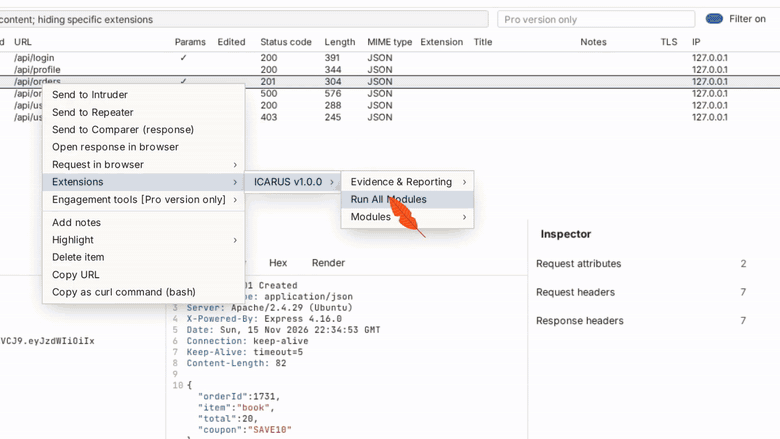
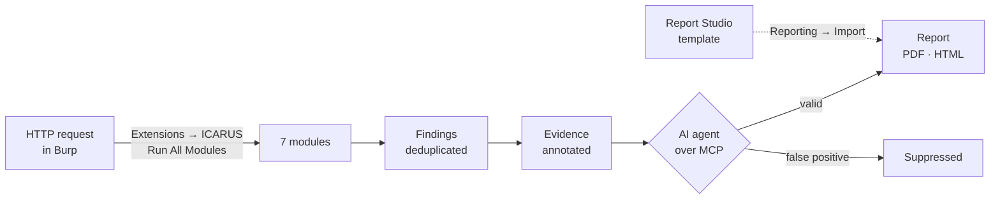
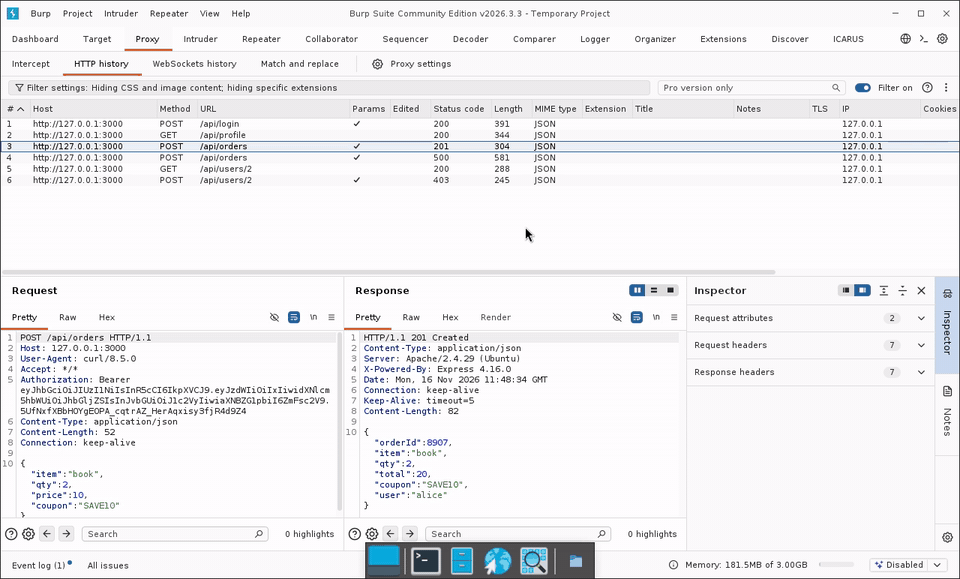
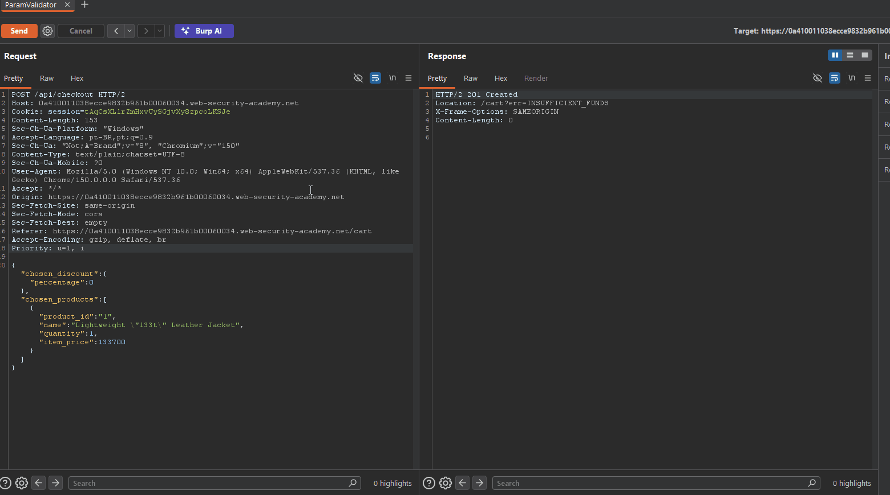
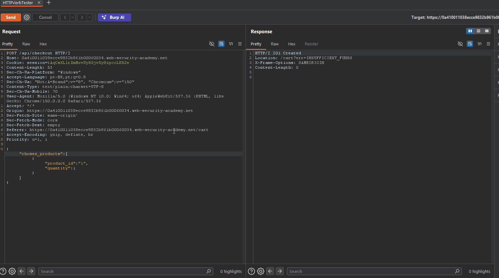
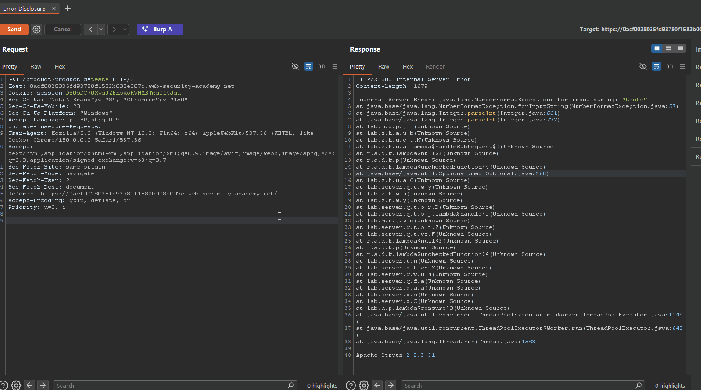
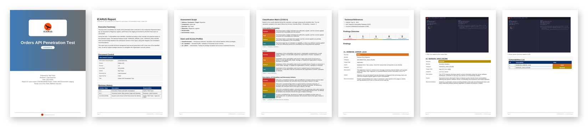
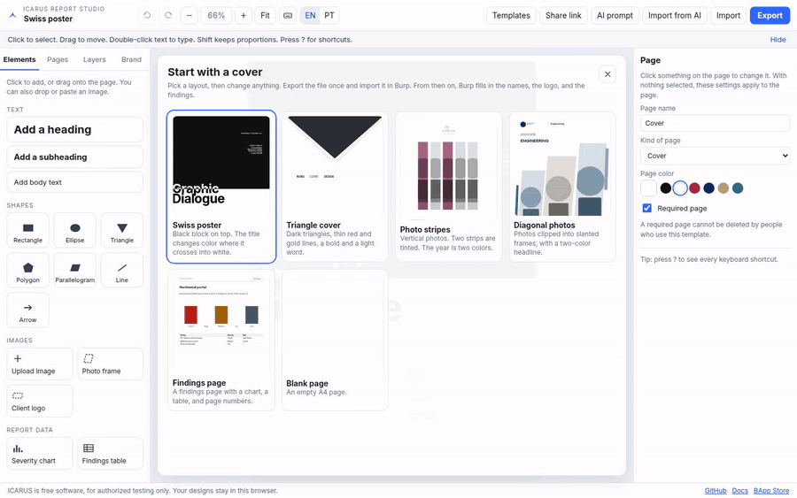
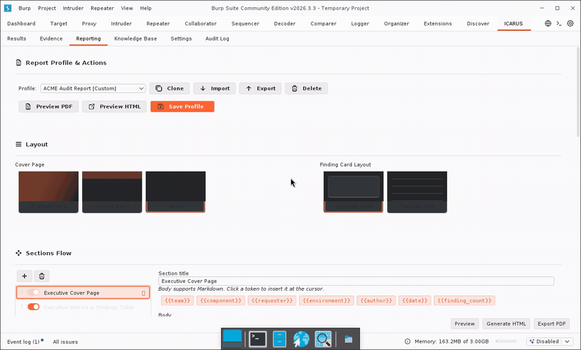

<div align="center">


# ICARUS

**One request in. One validated pentest report out.**

An AI-native offensive security extension for Burp Suite: seven test modules in one click,<br>
annotated evidence, an MCP server for your AI agent, and reports you design like a poster.

<p>
  <a href="https://github.com/IcarusSec/ICARUS/actions/workflows/build.yml"></a>
  <a href="https://github.com/IcarusSec/ICARUS/releases/latest"></a>
  <a href="LICENSE"></a>
  
  
  
  <a href="https://buymeacoffee.com/icarussec"></a>
</p>

<p>
  <a href="#-quick-start"><b>Quick start</b></a> ·
  <a href="#-how-it-works"><b>How it works</b></a> ·
  <a href="#-find--seven-modules-one-click"><b>Modules</b></a> ·
  <a href="#-validate--let-your-ai-agent-drive"><b>AI agents (MCP)</b></a> ·
  <a href="#-report--design-once-every-report-wears-it"><b>Reports</b></a> ·
  <a href="https://icarussec.github.io/ICARUS/studio/"><b>Report Studio (live)</b></a> ·
  <a href="https://icarussec.github.io/ICARUS/"><b>Docs</b></a>
</p>



<sub>From the ICARUS launch film. The film rebuilds the real screens; every other GIF on this page is a real screen recording.</sub>

</div>

---

## Why ICARUS

Most of a pentest is not finding the bug. It is proving it, cleaning up the false positives, and writing the report.
ICARUS covers the whole flight path inside Burp, from the first request to the PDF your client reads.

| 🔎 **Find** | 🧾 **Prove** | 🤖 **Validate** | 📄 **Report** |
|---|---|---|---|
| Seven modules run from one right-click, with WAF evasion built in. | Every finding keeps its request, response and annotated screenshots. | Your AI agent replays findings live over MCP and drops the false positives. | Themed PDF and HTML reports, from templates you design in a browser. |

## 🧭 How it works



## ⚡ Quick start

1. Download `icarus-<version>.jar` from the [**latest release**](https://github.com/IcarusSec/ICARUS/releases/latest).
2. In Burp Suite, open **Extensions → Add**, choose **Java**, and select the JAR.
3. Right-click any request in **Proxy**, **Repeater** or **Target**, then choose **Extensions → ICARUS → Run All Modules**.

> [!NOTE]
> ICARUS is on GitHub now and is coming to the **BApp Store** soon.

## 🔎 Find · seven modules, one click

<p align="center">
  
</p>

| Module | What it tests | Real result on the demo API |
|---|---|---|
| [**ParamValidator**](docs/modules/param_validator.md) | JSON, URL and form parameters: boolean and time-based SQLi, NoSQL, command injection, path traversal, HPP, format strings, XSS. Detects WAF blocks and jumps to CRS 4-tuned evasion payloads. | `STRING_XSS` on `coupon` |
| [**HTTP Verb Tester**](docs/modules/http_verb.md) | Every method (`GET`, `HEAD`, `OPTIONS`, `TRACE`, …) against the endpoint, to find misconfigurations. | `ACCEPTED_METHOD`: `TRACE` accepted |
| [**JWT Checker**](docs/modules/jwt_checker.md) | `alg=none`, signature stripping, missing claims, weak MAC, `kid` / `jku` / `x5u` / `x5c` probes. Asks before it sends active tests. | `ACTIVE_HIT` for `alg:none`, `MISSING_EXP` |
| **Sensitive Headers** | Version banners and missing security headers. | `VERSION_DISCLOSURE`: Apache/2.4.29 |
| [**Rate Limit Tester**](docs/modules/rate_limit.md) | A concurrent request burst with 429 / backoff detection and bypass attempts. | 50 requests sent, 1 finding |
| [**Passive Error Detector**](docs/modules/passive_scanners.md) | 500+ responses, stack traces and SQL errors as traffic crosses the proxy. | `VERBOSE_ERROR_LEAK` on `/api/orders` |
| **Postman Export** | Exports the request to a Postman collection for the dev team. | — |

**AutoAuth** replaces Burp macros: highlight a token, map it once, and ICARUS refreshes and injects it in the background. [Read more](docs/features/autoauth.md).

<details>
<summary><b>More recordings: ParamValidator and HTTP Verb Tester</b></summary>
<br>
<p align="center"></p>
<p align="center"></p>
</details>

## 🧾 Prove · evidence you can hand over

<p align="center">
  
</p>

- **Two-phase annotation.** Clean the noise, then draw boxes and arrows on the request and response.
- **Master-detail Evidence Manager.** Rename, reorder and curate findings and their screenshots.
- **Retest Mode.** Stamps `FIXED` or `NOT FIXED` on the evidence when you come back.
- **Portable projects.** An `.icarus` file carries the findings, evidence, audit log, suppression rules and report profiles to another machine (**Evidence → Import Project…**).

[Evidence Manager guide →](docs/features/evidence_manager.md)

## 🤖 Validate · let your AI agent drive

ICARUS hosts its own [Model Context Protocol](https://modelcontextprotocol.io) server over Streamable HTTP. Turn it on in **ICARUS → Settings → Enable Local MCP Server**, copy the port and the bearer token, then connect your agent:

```bash
claude mcp add --transport http icarus http://127.0.0.1:<PORT>/mcp \
  --header "Authorization: Bearer <TOKEN>"
```

<details>
<summary>Other MCP clients (JSON config)</summary>

```json
{
  "mcpServers": {
    "icarus": {
      "type": "http",
      "url": "http://127.0.0.1:<PORT>/mcp",
      "headers": { "Authorization": "Bearer <TOKEN>" }
    }
  }
}
```
</details>

Then ask in plain language:

> *Validate the ICARUS findings, suppress the false positives, and create a PDF report.*

The agent lists the findings, replays each one live (`rescan_finding`), suppresses what does not hold up, and calls `generate_icarus_report`.

| Group | Tools |
|---|---|
| **Findings** (11) | `list_findings` `get_finding` `get_finding_traffic` `add_finding` `suppress_finding` `unsuppress_finding` `get_passive_findings` `clear_passive_findings` `clear_all_findings` `get_reportable_findings` `get_audit_log` |
| **Scan & validate** (8) | `trigger_scan` `rescan_finding` `get_scan_status` `validate_finding` `exploit_finding` `find_attack_chains` `simulate_attack_chain` `get_project_context` |
| **Evidence** (8) | `capture_evidence` `get_evidence` `list_evidence` `set_evidence_caption` `set_evidence_included` `move_evidence` `remove_evidence` `reorder_evidence` |
| **Reporting** (3) | `generate_icarus_report` `get_report_config` `update_report_config` |
| **Knowledge base** (4) | `list_kb_vulnerabilities` `upsert_kb_vulnerability` `delete_kb_vulnerability` `create_finding_from_kb` |

> [!IMPORTANT]
> **A human stays in the loop.** `exploit_finding` and knowledge-base edits open a real approval dialog in Burp. It shows the exact request, and nothing is sent until someone clicks **Approve**. An MCP client cannot approve its own action. The server binds to `127.0.0.1`, needs the bearer token on every request, and refuses browser origins that are not local.

## 📄 Report · design once, every report wears it

<p align="center">
  
</p>

- **Report profiles.** Drag-and-drop sections, Master-Detail Markdown with `{{variables}}`, and themes.
- **Export** to themed HTML, or offline to PDF with OpenPDF. Nothing leaves your machine.
- **Built-in profiles** (Executive Modern, Classic Technical), or your own.

### 🎨 Report Studio

Design the report in your browser at **[icarussec.github.io/ICARUS/studio](https://icarussec.github.io/ICARUS/studio/)**, as you would a poster. Each page is a free-form A4 canvas: drag, resize, rotate, group and snap. Fields such as `{{client}}` and `{{count_critical}}` are filled by Burp when it generates the report.

<p align="center">
  
</p>

<p align="center">
  
</p>

Then take it into Burp: **Export → JSON for ICARUS**, and in Burp **ICARUS → Reporting → Import**. Every report you export from then on uses the new design.

<p align="center">
  
</p>

<details>
<summary><b>Report Studio details</b></summary>
<br>

- **Open it:** <https://icarussec.github.io/ICARUS/studio/>, or locally from [`docs/studio/index.html`](docs/studio/index.html).
- **The file:** a report profile (`schemaVersion` 1). Each designed page is a section with `rendererKey` `CANVAS_PAGE`.
- **Share:** **Share link** copies a URL that opens the design in another browser. For designs with large photos, send the JSON.
- **Preview:** Print / PDF and HTML preview include every page, filled with sample data from the Brand tab. Burp's PDF uses the same coordinates and fonts.
- **Images** are stored inside the template as JPEG or PNG, so the Burp PDF can read them.
- **AI assist** copies a prompt that documents the page format, then checks the JSON you paste back. The page does not call an AI API.
- **Privacy:** nothing is uploaded. Drafts stay in the browser. The studio is in English and Brazilian Portuguese.
- **Donation links** stay hidden until the placeholders in [`docs/studio/assets/config.js`](docs/studio/assets/config.js) are replaced.
</details>

## 🛠 Build from source

The build script downloads the Montoya API, OpenPDF, the MCP SDK and the other libraries, and packs one fat JAR.

```bash
cd icarus-extension
./build.sh                                               # Linux / macOS
powershell -ExecutionPolicy Bypass -File build.ps1       # Windows
```

The JAR is written to `icarus-extension/build_manual/libs/icarus-<version>.jar`. Load it with **Extensions → Add → Java**.

## 📚 Documentation

| Start here | Features | Modules | Architecture |
|---|---|---|---|
| [Getting started](docs/getting_started.md) | [Reporting engine](docs/features/reporting.md) | [ParamValidator](docs/modules/param_validator.md) | [Overview](docs/architecture/overview.md) |
| [Testing workflows](docs/workflows.md) | [Evidence Manager](docs/features/evidence_manager.md) | [HTTP Verb Tester](docs/modules/http_verb.md) | [Core concepts](docs/architecture/core_concepts.md) |
| [Changelog](CHANGELOG.md) | [AutoAuth](docs/features/autoauth.md) | [JWT Checker](docs/modules/jwt_checker.md) · [Rate Limit](docs/modules/rate_limit.md) · [Passive](docs/modules/passive_scanners.md) | [Third-party notices](THIRD-PARTY-NOTICES.md) |

## 🤝 Contributing

Issues and pull requests are welcome. Read [CONTRIBUTING.md](CONTRIBUTING.md) and the [Code of Conduct](CODE_OF_CONDUCT.md) first. To report a vulnerability in ICARUS itself, follow [SECURITY.md](SECURITY.md) and do not open a public issue.

If ICARUS saves you an afternoon of report writing, a ⭐ helps other testers find it, and a [coffee](https://buymeacoffee.com/icarussec) keeps the project going.

<a href="https://buymeacoffee.com/icarussec"></a>

<a href="https://star-history.com/#IcarusSec/ICARUS&Date">
  
</a>

## ⚠️ Disclaimer

> [!WARNING]
> ICARUS is for security research, defensive engineering, authorized penetration tests and secure development.
> **Use it only against systems, networks and applications that you are explicitly authorized to test.**

## ⚖️ License

Released under the [MIT License](LICENSE).
